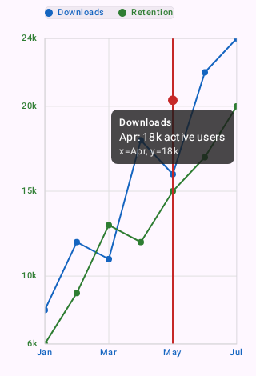
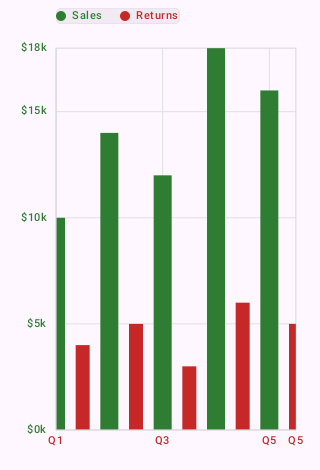
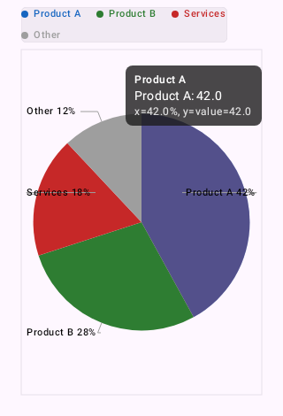
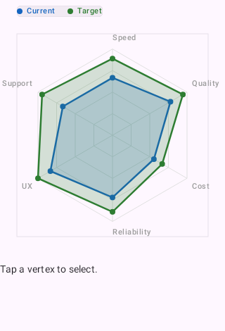
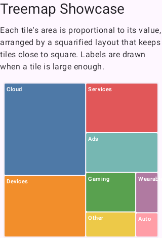
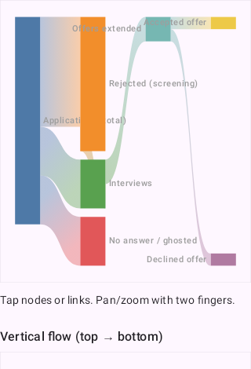

# ComposePlotLib

**A charting library for Kotlin Multiplatform and Compose Multiplatform — 26 chart families, one
declarative API, Android and iOS.** A modern successor to MPAndroidChart, built Compose-first around
immutable specs and explicit state.

<p align="center">
  
  
  
  <br>
  
  
  
</p>

## Quick start

Add the repository (GitHub Packages currently requires a token — see
[Install](#install-github-packages)):

```kotlin
// settings.gradle.kts
dependencyResolutionManagement {
    repositories {
        mavenCentral()
        google()
        maven {
            url = uri("https://maven.pkg.github.com/mena97villalobos/ComposePlotLib")
            credentials {
                username = providers.gradleProperty("gpr.user").orNull ?: System.getenv("GITHUB_ACTOR")
                password = providers.gradleProperty("gpr.key").orNull ?: System.getenv("GITHUB_TOKEN")
            }
        }
    }
}
```

Add the dependency — most apps only need `chart-compose`, which re-exports `chart-core`:

```kotlin
// build.gradle.kts
kotlin {
    sourceSets {
        commonMain.dependencies {
            implementation("com.mena97villalobos.composeplotlib:chart-compose:1.2.0")
        }
    }
}
```

Build an immutable spec, then render it. Pan/zoom and selection state are explicit and hoistable:

```kotlin
import androidx.compose.runtime.Composable
import com.mena97villalobos.composeplotlib.chart.LineChart
import com.mena97villalobos.composeplotlib.chart.defaultViewport
import com.mena97villalobos.composeplotlib.chart.state.rememberChartSelectionState
import com.mena97villalobos.composeplotlib.chart.state.rememberChartViewportState
import com.mena97villalobos.composeplotlib.core.model.ChartPoint
import com.mena97villalobos.composeplotlib.core.model.LineSeries
import com.mena97villalobos.composeplotlib.core.spec.LineChartSpec

@Composable
fun BasicLineChart() {
    val spec =
        LineChartSpec(
            series =
                listOf(
                    LineSeries(
                        id = "downloads",
                        label = "Downloads",
                        points = listOf(ChartPoint(0.0, 1.0), ChartPoint(1.0, 3.0), ChartPoint(2.0, 2.0)),
                    ),
                ),
        )
    LineChart(
        spec = spec,
        viewportState = rememberChartViewportState(initialViewport = defaultViewport(spec)),
        selectionState = rememberChartSelectionState(),
    )
}
```

## Chart families

All 26 families ship today. See
[`docs/chart-families-overview.md`](./docs/chart-families-overview.md) for the full reference.

| Group | Families |
|-------|----------|
| Cartesian | `LineChart`, `BarChart`, `StackedBarChart`, `StackedAreaChart`, `ScatterChart`, `BubbleChart`, `CombinedCartesianChart`, `CandlestickChart`, `BoxPlotChart`, `ViolinChart`, `WaterfallChart`, `BulletChart`, `ParallelCoordinatesChart` |
| Radial | `PieChart` (+ donut), `RadarChart`, `PolarChart`, `GaugeChart`, `RadialBarChart`, `SunburstChart` |
| Hierarchical | `TreemapChart`, `CirclePackChart` |
| Flow | `SankeyChart`, `FunnelChart` |
| Matrix | `HeatmapChart`, `CalendarHeatmapChart` |
| Minimal | `Sparkline` (axis-less wrapper) |

Cross-cutting features include logarithmic axis scales, null/missing-data gap handling
(`ChartPoint.gap`), per-point data labels (`DataLabelsSpec`), an interactive legend
(`hiddenSeriesIds`), an annotations layer (`ChartAnnotation`), area and threshold-band fills
(`LineStyle.areaFill`), reference lines, marker shapes with per-point styling, drill-down, range
brushing, linked viewports, and PNG export.

## Compatibility

| | |
|---|---|
| Kotlin | 2.4.0 |
| Compose Multiplatform | 1.11.1 |
| Android | `minSdk` 28, `compileSdk` 36 |
| JVM target | 11 |
| iOS | `iosArm64`, `iosSimulatorArm64` (no `iosX64` — Intel simulators are not supported) |

## Install (GitHub Packages)

Artifacts are published to **GitHub Packages** from the Release workflow (tag `v1.2.3` publishes
version `1.2.3`). GitHub's Maven registry requires authentication **even for public packages**, so
consumers must supply a token with `read:packages`:

```properties
# ~/.gradle/gradle.properties
gpr.user=YOUR_GITHUB_USERNAME
gpr.key=YOUR_TOKEN_WITH_read:packages
```

For planner-only usage with no Compose dependency:

```kotlin
implementation("com.mena97villalobos.composeplotlib:chart-core:1.2.0")
```

Android, iOS (`iosArm64`, `iosSimulatorArm64`) and Kotlin-Multiplatform-metadata artifacts are
published for both modules; `chart-core` additionally publishes a JVM artifact. The release
workflow publishes the Apple targets from a macOS job.

## Documentation

| Topic | Doc |
|------|-----|
| All chart families | [`docs/chart-families-overview.md`](./docs/chart-families-overview.md) |
| Public API & state | [`docs/api-and-state.md`](./docs/api-and-state.md) |
| Styling & theming | [`docs/style-and-theme.md`](./docs/style-and-theme.md) |
| Axis cookbook (category / time) | [`docs/axis-category-time-cookbook.md`](./docs/axis-category-time-cookbook.md) |
| Viewport constraints & axis lock | [`docs/viewport-configuration.md`](./docs/viewport-configuration.md) |
| Marker & tooltip placement | [`docs/marker-tooltip-placement.md`](./docs/marker-tooltip-placement.md) |
| iOS library usage | [`docs/ios-library-usage.md`](./docs/ios-library-usage.md) |
| Architecture | [`docs/architecture.md`](./docs/architecture.md) |
| Full documentation index | [`docs/README.md`](./docs/README.md) |

API reference is published to GitHub Pages via Dokka on each release.

## Platforms

The library targets **Android** and **iOS**. `chart-core` and `chart-compose` both compile for iOS
and are consumable from any Compose Multiplatform app — see
[`docs/ios-library-usage.md`](./docs/ios-library-usage.md). The bundled runnable sample is
Android-only.

```shell
./gradlew :samples:android-showcase:assembleDebug
```

## Modules

| Module | Role |
|--------|------|
| [`chart-core`](./chart-core/src) | Non-UI engine: math, geometry, specs, viewport, transforms, planner, draw commands |
| [`chart-compose`](./chart-compose/src) | Public Compose API and rendering |
| [`samples/android-showcase`](./samples/android-showcase/src) | Android showcase app with Roborazzi screenshot tests |

## Contributing

Contributions are welcome. Start with [`AGENTS.md`](./AGENTS.md) for module boundaries, the
showcase/docs obligations for new chart families, and the required `gradlew` commands;
[`docs/roadmap.md`](./docs/roadmap.md) tracks the open backlog.

Before opening a PR, run what CI runs:

```shell
./gradlew ktlintCheck apiCheck :chart-core:verifyChartCorePurity \
  :chart-core:jvmTest :chart-core:testDebugUnitTest :chart-compose:testDebugUnitTest \
  :samples:android-showcase:verifyRoborazziDebug :samples:android-showcase:assembleDebug
```

## License

Licensed under the [Apache License, Version 2.0](./LICENSE).
