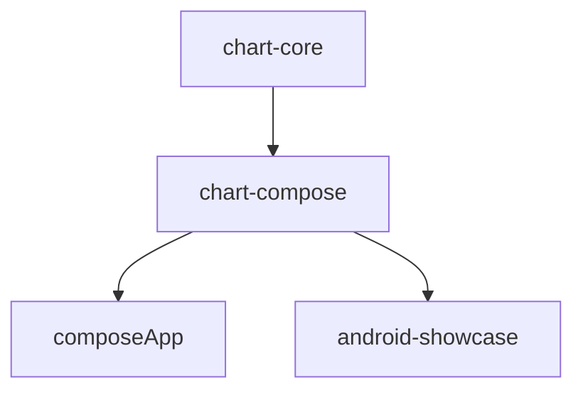
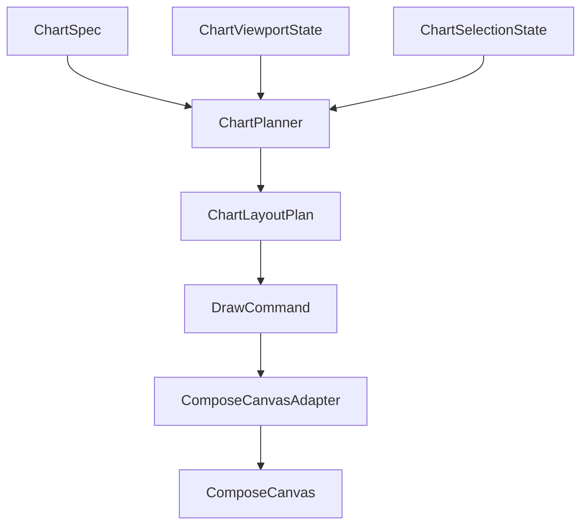

# Architecture

## Purpose
`ComposePlotLib` is a multiplatform charting library built around a separation between:
- platform-agnostic chart semantics and math
- Compose-facing public APIs and rendering
- host/demo applications

The current implementation is intentionally small, but the architecture is already shaped for extension.

**Production and next milestones:** [`production-readiness-next-steps.md`](production-readiness-next-steps.md).

## Module Graph
Current modules:
- `:chart-core`
- `:chart-compose`
- `:composeApp`
- `:samples:android-showcase`

Dependency direction:

## Core Design Principle
All chart behavior should flow through a planning pipeline:

This separation is the most important architectural decision in the codebase.

## `chart-core`
`chart-core` is the non-UI engine.

It currently contains:
- geometry primitives
- numeric ranges
- data-domain types
- viewport and transform math
- visible-range filtering
- selection/highlight logic
- immutable chart models/specs
- layout planning types and draw commands

`chart-core` must stay free of Compose UI types.

### Main packages
- `geometry`
  Shared numeric primitives like `OffsetD`, `RectD`, `SizeD`, `InsetsD`
- `math`
  `FpMath` floating-point helpers (degenerate span checks, absolute and relative near-equality, zoom scale sanitization)
- `range`
  Numeric interval types like `ClosedRangeD`
- `domain`
  Data-space types such as `XyPoint` and `DataDomain`
- `viewport`
  Chart window state and constraints (`ViewportState` canonicalizes domains and sanitizes viewports each update so clamps and span limits stay finite)
- `transform`
  Domain-to-pixel and pixel-to-domain conversion
- `visible`
  Visible range derivation from viewport (line windowing uses the domain **x × y** rectangle; vertical bars use pixel bar width plus a small horizontal slack at plot edges; horizontal bars use vertical band slack; scatter/line vertex markers keep points whose **disc** intersects the plot in pixels via `RectD.intersectsDisc`)
- `selection`
  Highlight target and nearest-point resolution
- `model`
  Immutable chart data like `LineSeries`, `ScatterSeries`, `BarGroup`, `PieChartSlice`, `ChartPoint`
- `spec`
  Immutable chart configuration such as `LineChartSpec`, `ScatterChartSpec`, `BarChartSpec`, `PieChartSpec`, `AxisSpec`, `ChartAccessibilitySpec` / `ChartLiveRegionMode`
- `layout`
  Planner inputs, outputs, ticks, legend entries, and draw commands

## `chart-compose`
`chart-compose` is the public Compose-facing module.

It currently contains:
- public chart composables: `LineChart`, `BarChart`, `StackedBarChart`, `ScatterChart`, `CombinedCartesianChart`, `PieChart`
- public state types: `ChartViewportState`, `ChartSelectionState`
- helpers: default viewport, gesture config (**`ChartGestureConfig`** + companion presets for hosts / iOS QA), markers + **`ChartMarkerPlacement`** / **`ChartMarkerCalloutLeader`**, no-data, **`ChartAnimationPolicy`** (opt-in programmatic viewport easing, optional gesture chase, marker highlight fade in/out on selection / clear, optional **`LineChart`** data morph), **`MaterialChartPalette`** / **`withMaterialSeriesColors`**-style helpers (`materialChartPalette()`, `Color.toChartColor()`), custom accessibility actions
- internal gesture adapter, fling runtime, accessibility semantics (including optional **marker focus handoff** when `ChartAccessibilitySpec.requestFocusOnMarker` is set on a spec, and optional **Shift+arrow selection roam** when `keyboardSelectionRoamEnabled` is set)
- internal Compose canvas adapter and family renderers
- **`androidMain` / `iosMain`** for small platform probes (e.g. reduced-motion preference)

This module is allowed to depend on Compose types, pointer input, text measurement, and canvas APIs.

## Host Modules
### `composeApp`
This is the thin shared app host. It should remain a lightweight way to preview the current milestone. It runs **`ComposePlotApp()`**, which **must** cycle **line, bar, stacked bar, horizontal bar, scatter, pie, combined, and domain axes** previews on Android and iOS (see **`AGENTS.md` → Obligations** when adding chart families). **`samples/android-showcase`** adds richer demos and Roborazzi.

### `samples/android-showcase`
This is the main demo surface and should be treated as the visual verification app.

It currently contains:
- sample data providers
- dedicated chart showcase screens
- a small host that can switch between **line**, **bar**, **stacked bar**, **horizontal bar**, **scatter**, **pie**, and **domain axes** demos
- Android **Roborazzi** screenshot tests for regression detection (`verifyRoborazziDebug`)

## Current Rendering Pipeline
The current rendering pipeline is:

1. App builds `LineChartSpec`, `BarChartSpec`, `StackedBarChartSpec`, `ScatterChartSpec`, or `PieChartSpec`
2. Composable resolves a default viewport if no state is supplied
3. `ChartPlanner` runs on `ChartLayoutInput` (with **`labelLayoutScale`** aligned to host font scale in built-in composables); Compose typically performs a **measured second pass** after `TextMeasurer` fills tick/legend metrics (and **pie slice label** metrics when `PieChartSpec.sliceLabels` is enabled). Cartesian composables reuse **`ChartPlanner.computeCartesianTickValuePass`** (`TickValuePass`) across those passes when the viewport and primary axes are unchanged, then the planner computes:
   - plot bounds
   - axis ticks (overlap suppression + canvas-edge hiding)
   - legend entries
   - draw commands
4. `ComposeCanvasAdapter` draws commands to Compose canvas (baseline-aligned `Text` / legend when planner supplies metrics; optional save-layer `Group` compositing via `ChartChromeTheme`)
5. Gesture handling updates viewport and selection; optional **animated render viewport** eases programmatic `ChartViewportState` changes toward the target, and optionally **chases** gesture-driven targets when **`ChartAnimationPolicy.gestureViewportEasingEnabled`** is true (otherwise gestures snap each frame)
6. Recomposition regenerates the plan and redraws

## Planner passes (`chart-core`)

The planner matches a **multi-pass** shape (measurement is host-driven; core reads `ChartTextMeasurementInput`):

| Stage | Role | Primary API |
|-------|------|-------------|
| Bounds | Canvas size + viewport | `ChartLayoutInput` → `toPlanningBounds()` |
| Tick values | Domain ticks before pixel density | `TickValuePass`, `ChartPlanner.computeCartesianTickValuePass` |
| Chrome | Legend rows + reserved insets for axes | `ChartChromeLayout.kt` (`buildLegendEntries`, `buildReservedRegions`) |
| Final cartesian layout | Plot `RectD`, `ChartTransform`, resolved `AxisTick` lists | `CartesianLayoutPlanner` → `CartesianFrame` |
| Draw plan | `DrawCommand` lists (grid, series, axes, selection) | `ChartPlanner.planLineChart` / `planBarChart` / `planScatterChart` / `planCombinedCartesianChart` |

`planPieChart` uses chrome helpers + radial layout only (empty axis ticks). See **`docs/production-readiness-next-steps.md`** → **Planner evolution** for the roadmap diagram.

## Important Current Constraints
- Text placement still uses some fixed offsets and heuristic optical alignment
- Legend and axis ticks use measurement-assisted layout, but long labels, extreme font scale, and iOS parity remain stress cases
- Draw commands stay a small sealed set (`Line` through `Arc`, plus `Path`, `ClipRect`, `Group`); new paint features should extend this set before ad-hoc canvas code
- The selection model is point-based and sufficient for line/scatter/bar first slices, but not yet generalized
- **Chart families (product order):** scatter, **pie/donut**, and **combined** cartesian (multi-layer) are **shipped**; see **[`design-combined-cartesian-layers.md`](design-combined-cartesian-layers.md)** and [`production-readiness-next-steps.md`](production-readiness-next-steps.md) (**New Chart Families**).

## Combined cartesian layers (shipped)
**Combined** charts overlay line, bar, and/or scatter layers with shared *X* and one or two *Y* scales. Planning entry point: **`ChartPlanner.planCombinedCartesianChart`** → **`CombinedCartesianChartPlan`** (wraps a single **`ChartLayoutPlan`** for the adapter; secondary *Y* ticks live on the plan wrapper). Compose: **`CombinedCartesianChart`**. Semantics and extension options: **[`design-combined-cartesian-layers.md`](design-combined-cartesian-layers.md)**.

## Why This Architecture Matters
This structure makes it possible to:
- add new chart types without rewriting viewport math
- test transforms and selection without UI
- reuse the same planning layer across Android and iOS
- keep public API declarative instead of mutating hidden chart objects
