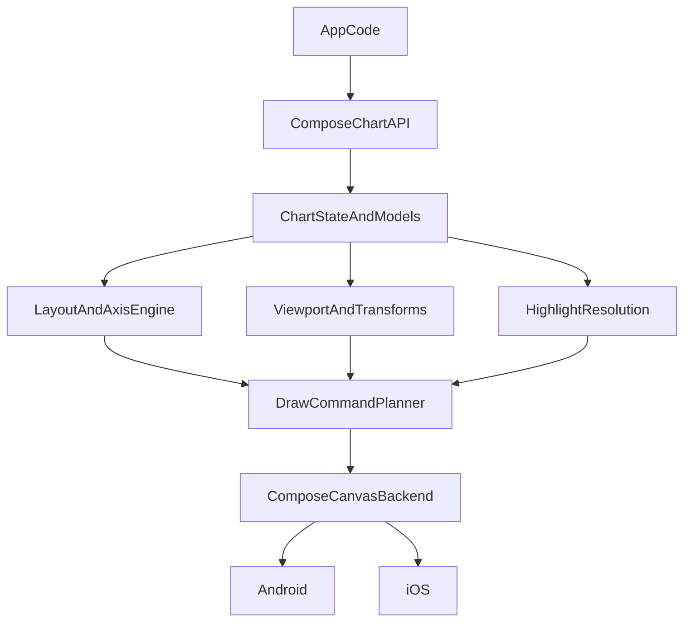

# ComposePlotLib Implementation Roadmap

For **current milestone status, production gaps, and next engineering tasks**, prefer **`production-readiness-next-steps.md`**. This roadmap is the **long-range** view derived from reviewing the legacy MPAndroidChart codebase.

## Goal
Build `ComposePlotLib` as a Kotlin Multiplatform and Compose Multiplatform charting library inspired by MPAndroidChart, but with a modern declarative API that works on Android and iOS.

This roadmap is based on a review of the `MPChartLib` and `MPChartExample` modules in the parent repository. The objective is not a literal port. The objective is to preserve the useful feature set while replacing Android-specific and setter-heavy APIs with a multiplatform architecture.

## Source Review Summary
The original library is organized around these major subsystems:

- Chart shells and lifecycle
- Shared data models and datasets
- Axis, legend, description, and marker components
- Rendering pipeline and chart-specific renderers
- Viewport and transform math
- Highlight resolution and selection
- Gesture handling and viewport jobs
- Demo application with chart examples and performance scenarios

The most important source areas reviewed were:

- `../MPChartLib/src/main/java/com/github/mikephil/charting/charts`
- `../MPChartLib/src/main/java/com/github/mikephil/charting/data`
- `../MPChartLib/src/main/java/com/github/mikephil/charting/components`
- `../MPChartLib/src/main/java/com/github/mikephil/charting/renderer`
- `../MPChartLib/src/main/java/com/github/mikephil/charting/highlight`
- `../MPChartLib/src/main/java/com/github/mikephil/charting/listener`
- `../MPChartLib/src/main/java/com/github/mikephil/charting/utils`
- `../MPChartExample`

## Proposed Target Architecture

## Recommended Project Structure
The live project already uses focused modules **`chart-core`**, **`chart-compose`**, **`samples:android-showcase`**, and **`composeApp`** (plus **`iosApp`**). Layout/planning and draw commands live in **`chart-core`** (there is no separate `:chart-render` module today).

Recommended end state (reference — optional future split):

- `:chart-core`
  Shared models, geometry, transforms, viewport state, highlight logic, animation state abstractions
- `:chart-render`
  Shared layout and render-planning code, draw commands, chart-family render planners
- `:chart-compose`
  Public Compose Multiplatform API and Compose canvas backend
- `:samples:android-showcase`
  Separate Android showcase app
- `:docs`
  Documentation sources, screenshots, and example references

Pragmatic first step if you want to keep the project smaller initially:

- `:chart-core`
- `:chart-compose`
- `:samples:android-showcase`

## Step-By-Step Plan

### Phase 0. Freeze v1 scope
Decide exactly what ships in v1 and what is deferred.

Recommended v1 (chart families in **implementation order**; status as of current milestone):

- Line chart *(shipped)*
- Bar chart *(shipped)*
- **Scatter chart** *(shipped — `ScatterChartSpec`, `planScatterChart`, `ScatterChart`; shared cartesian frame with line/bar)*
- **Pie or donut chart** *(shipped — `PieChartSpec`, `PieChart`, showcase + Roborazzi; radial polish in production-readiness backlog)*
- Shared axis and legend system
- Selection and highlighting
- Pan and zoom for cartesian charts
- Compose tooltip or marker slots
- Android showcase app
- Android and iOS support through Compose Multiplatform

Recommended later:

- Bubble chart
- Radar chart
- Candlestick chart
- **Combined / multi-layer cartesian charts** — gated on planner work (see `docs/production-readiness-next-steps.md`, **New Chart Families**)
- Full combined-chart parity vs MPAndroidChart (feature-complete)
- Rotation-heavy radial gestures
- Export APIs
- Large-dataset decimation strategies beyond the first release

Deliverables:

- `docs/feature-inventory.md`
- A parity matrix against MPAndroidChart
- A short v1 scope statement in the root `README.md`

### Phase 1. Design the public API
Lock down the library shape before implementing renderers.

Design goals:

- Immutable data/config inputs
- Composable chart APIs per family
- Kotlin-first DSLs where they improve ergonomics
- No Android platform types in common APIs
- Lambda-based formatting and interaction hooks
- Remembered state objects for viewport and selection

Recommended public concepts (rollout order: **line/bar/scatter + pie/donut shipped** → combined when planner-ready):

- `LineChart(...)`, `BarChart(...)`, `ScatterChart(...)`, `PieChart(...)` *(implemented)*; combined surfaces *(gated)*
- `ChartViewportState`
- `ChartSelectionState`
- Immutable specs: `LineChartSpec`, `BarChartSpec`, `ScatterChartSpec`, `PieChartSpec` *(today)*
- `AxisSpec`, `LegendSpec`, `GridSpec`, `SelectionSpec`, `AnimationSpec`
- `marker = { selection -> ... }`
- `valueFormatter = { value, context -> ... }`

Deliverables:

- API design doc
- Example snippets for the first chart families
- Naming guidelines to keep the API consistent

### Phase 2. Build `chart-core`
Implement platform-agnostic logic in `commonMain`.

Core responsibilities:

- Geometry and bounds types
- Domain models for entries and series
- Axis range calculations
- Tick generation inputs
- Visible range calculations
- Viewport state
- Domain-to-pixel transforms
- Highlight lookup
- Selection models
- Animation phase state

Do not let `chart-core` depend on:

- Android `Canvas`
- `Drawable`
- `View`
- `MotionEvent`
- platform fonts or resource IDs

Deliverables:

- Pure unit tests for transforms and highlight resolution
- Benchmarks for large point collections
- Clearly separated common model packages

### Phase 3. Build `chart-render`
Turn chart state into platform-neutral draw commands.

**Today this role is filled by `chart-core`** (e.g. `ChartPlanner`, `DrawCommand`, layout plans). A separate `:chart-render` module remains an optional future split.

Responsibilities:

- Axis layout
- Legend layout
- Content-rect calculation
- Line path planning
- Scatter point planning *(circles only; no polylines — shipped)*
- Bar geometry planning
- Pie arc planning
- Highlight overlay planning
- Label placement
- Clip and layer instructions

Suggested primitives:

- line
- polyline
- path
- rect
- roundRect
- circle
- arc
- text
- clipRect
- save or restore

Deliverables:

- Deterministic render planners
- Golden tests for command output
- Shared layout engine for chart families

### Phase 4. Build `chart-compose`
Use Compose Multiplatform as the first rendering backend.

Responsibilities:

- Adapt draw commands to Compose canvas
- Connect chart state to Compose state and recomposition
- Provide platform text measurement bridges
- Provide pointer input adapters for Android and iOS
- Expose public composables
- Expose marker and overlay slots
- Add semantics for accessibility

Deliverables:

- Base chart shell composable
- Shared theme-aware rendering
- Android and iOS smoke tests

### Phase 5. Implement chart families in order
Build chart families from shared infrastructure outward.

Recommended order (aligned with **`production-readiness-next-steps.md` → New Chart Families**):

1. Line chart *(shipped)*
2. Bar chart *(shipped)*
3. Scatter chart *(shipped)*
4. Pie or donut chart *(shipped — radial planner + `PieChart`)*
5. Combined cartesian chart *(shipped — multi-layer planner + `CombinedCartesianChart`)*
6. Bubble chart *(shipped 1.1.0 — per-point `ChartPoint.markerRadius` on `ScatterChart`)*
7. Radar chart *(shipped — `RadarChart`)*
8. Candlestick chart *(shipped 1.1.0 — `CandlestickChart`)*
9. Horizontal bar chart *(shipped — `BarChartOrientation.Horizontal`)*

(Also shipped beyond this original list: **Sankey**, **Heatmap**, **Gauge** families and the **Sparkline** wrapper.)

For each chart family:

- Define immutable model types
- Define style/config objects
- Build render planner
- Implement selection/highlighting
- Add showcase examples
- Add docs page with example code

### Phase 6. Add advanced behaviors
Once the basics work, add parity-critical features.

- Dual-axis support
- Grouped and stacked bars
- Area fills and gradients
- Programmatic viewport control
- Visible range constraints
- Combined chart draw ordering
- Limit or reference lines
- Streaming updates
- Optional fling or deceleration behavior

### Phase 7. Ship the Android showcase app
Create a dedicated sample application rather than extending the starter app forever.

The showcase app should demonstrate:

- Basic line chart *(Android showcase: styled/empty variants)*
- Multi-series line chart
- Filled line chart
- Realtime line chart
- Basic bar chart *(Android showcase)*
- Grouped and stacked bar chart
- Pie or donut chart
- Basic scatter chart *(Android showcase: styled/empty variants)*
- Combined chart
- Performance stress screen
- Chart in scroll or pager containers
- Theming and accessibility examples

The showcase app should use curated, reproducible datasets instead of only random values.

### Phase 8. Documentation
Treat documentation as part of implementation.

Required docs:

- Getting started
- Public API overview
- Data model guide
- Axis and legend guide
- Selection and tooltip guide
- Performance guide
- Accessibility guide
- Android showcase app guide
- Migration notes for MPAndroidChart users
- Contributor architecture notes

## Key Interface Improvements Over MPAndroidChart
MPAndroidChart is powerful, but it is heavily mutable and Android-specific. `ComposePlotLib` should improve these points:

- Replace `Entry -> DataSet -> Data -> chart.setData(data)` with immutable chart models
- Replace dozens of setters with grouped spec objects
- Replace manual `notifyDataSetChanged()` and `invalidate()` with state-driven updates
- Replace Java listener interfaces with lambdas or state flows
- Replace `MarkerView` subclasses with Compose content slots
- Replace raw float-index-based x labels with better typed domains where possible
- Keep viewport APIs, but expose them through a dedicated state object

## Immediate Next Tasks
Historical bootstrap list *(largely complete)*. For **current** engineering priorities, use **`production-readiness-next-steps.md`** (layout/text, performance, axes, marker UX, pie/donut polish, combined planner design).

1. ~~Restructure `ComposePlotLib` from a starter app into library modules plus showcase app modules.~~
2. ~~Write the initial public API proposal for line and bar charts.~~ *(Extended to scatter; see `api-and-state.md`.)*
3. ~~Implement `chart-core` geometry, ranges, and viewport math.~~
4. ~~Implement a minimal draw-command pipeline.~~
5. ~~Replace the starter `composeApp` sample with a first chart prototype screen.~~ *(`ComposePlotApp` cycles line, bar, scatter; Android showcase adds richer demos.)*
6. ~~Add the dedicated Android showcase app module.~~
7. ~~Add docs examples sourced from the showcase app.~~ *(Ongoing; see `showcase-guide.md`.)*

## Success Criteria
The first milestone should be considered successful when:

- `LineChart`, `BarChart`, and `ScatterChart` render on Android and iOS via **`ComposePlotApp`** (see **`AGENTS.md` → Obligations** when adding families); the Android showcase adds deeper demos and Roborazzi
- The API is declarative and Compose-first (immutable specs, explicit viewport/selection state)
- Pan, zoom, and selection work reliably on cartesian charts (line, bar, scatter)
- The Android showcase app has **line, bar, and scatter** example screens plus Roborazzi goldens
- The docs explain both usage and architecture clearly (`api-and-state.md`, `architecture.md`, this index)
