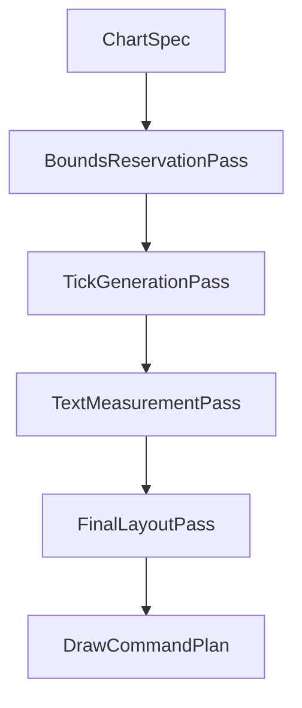

# Production Readiness Next Steps

## Purpose
This document is the **primary backlog** for taking `ComposePlotLib` from its current milestone to a **production-ready** charting library: what is done, what still blocks broad adoption, and what to do next.

It is implementation-focused so maintainers and AI agents can resume work quickly.

## Documentation map (read with this file)
| Document | Role |
|----------|------|
| [`AGENTS.md`](../AGENTS.md) | Contributor/agent rules, build commands, module boundaries |
| [`architecture.md`](architecture.md) | Pipeline diagram, module graph, constraints |
| [`api-and-state.md`](api-and-state.md) | Public API, specs, state, gestures |
| [`viewport-configuration.md`](viewport-configuration.md) | `ViewportConstraints`, axis lock, gestures |
| [`module-guide.md`](module-guide.md) | Where code belongs per module |
| [`showcase-guide.md`](showcase-guide.md) | Android showcase structure, Roborazzi |
| [`performance-benchmarks.md`](performance-benchmarks.md) | JMH module (`chart-core-benchmarks`), local runs, variance / CI expectations |
| [`ios-library-usage.md`](ios-library-usage.md) | Consuming charts from a KMP+iOS app (framework, `ComposeUIViewController`, SwiftUI bridge) |
| [`style-and-theme.md`](style-and-theme.md) | `ChartColor`, spec styles, `ChartChromeTheme`, light/dark notes |
| [`chart-families-overview.md`](chart-families-overview.md) | Short orienter per shipped family + links to deep detail |
| [`implementation-roadmap.md`](implementation-roadmap.md) | Long-range phases and MPAndroidChart-derived scope |
| [`feature-inventory.md`](feature-inventory.md) | Capability checklist vs classic chart libraries |
| [`android-showcase-plan.md`](android-showcase-plan.md) | Original showcase vision (module now exists) |
| [`ai-agent-full-backlog-prompt.md`](ai-agent-full-backlog-prompt.md) | AI agent system prompt + **residual mission index** (see file; shipped history stays in this backlog) |
| [`ai-agent-milestone-prompts.md`](ai-agent-milestone-prompts.md) | Copy-paste **residual** task prompts (open work only); retired: M3→M8, M7, M12–M16 |
| **This file** | **Production gaps, testing, next milestones** |

## Current state summary (milestone snapshot)
**In place today**
- **chart-core**: geometry, viewport math (`ViewportState`, `ViewportConstraints`, `ViewportAxisPolicy`), transforms, selection models, `ChartPlanner` (line + bar + **scatter** + **pie/donut planning**), `DrawCommand` plans, unit tests (viewport, planner, selection).
- **chart-compose**: `LineChart` / `BarChart` / **`StackedBarChart`** / **`ScatterChart`** / **`PieChart`** / **`RadarChart`** / **`CombinedCartesianChart`** / **`SankeyChart`** / **`HeatmapChart`** / **`CandlestickChart`** / **`GaugeChart`** / **`Sparkline`** (gauge / candlestick / sparkline new in 1.1.0), `ChartViewportState` / `ChartSelectionState`, `ChartGestureConfig` (tap/transform/double-tap zoom in|out|reset/fling), marker slot, **no-data** (`noData` / `noDataUi` / `ChartNoDataDefaults`), **animation** (`ChartAnimationPolicy`: opt-in programmatic viewport easing; optional **gesture viewport chase**; marker fade-in **and fade-out on selection clear** when duration > 0; optional **`LineChart`** same-topology **data** coordinate morph; reduced-motion respected), **accessibility** (Image role, focus opt-in, optional **marker focus handoff** via `ChartAccessibilitySpec.requestFocusOnMarker`, custom actions + `chartViewportAccessibilityActions`, optional keyboard pan/zoom/clear on cartesian charts, `ChartLiveRegionMode`, spec-driven descriptions).
- **Showcase**: line + bar + **scatter** + **pie/donut** + **radar** + **combined** + **sankey** + **heatmap** + **gauge** + **candlestick** + **domain axes** screens, sample specs, **Roborazzi** goldens (`verifyRoborazziDebug` / `recordRoborazziDebug`).
- **iOS**: supported as a **library** target — `chart-core` and `chart-compose` compile for iOS (CLI compile gates); integration notes in **`docs/ios-library-usage.md`**. There is no in-repo runnable iOS demo app.
- **Docs**: API, architecture, viewport guide, axis cookbook, marker placement, style/theme guide, chart-family overview, iOS library usage, production readiness (this file).

**Not production-ready yet (typical blockers)**
- Layout/text still fragile under long labels, large font scale, and unproven iOS measurement parity.
- Large-series performance is **partially** addressed (see **Performance Work**): line decimation + optional plot-width pixel budget ship in `chart-core` / `LineChart`; scatter caps + same pixel-budget hook ship (**M8**); cartesian **pass-2** tick reuse across Compose measurement passes ships (**M6**); JVM **JMH** harness ships in `:chart-core-benchmarks` (local `./gradlew :chart-core-benchmarks:jmh --no-configuration-cache`; see **`performance-benchmarks.md`**); **CI** micro-benchmark baselines remain optional; broader draw-command memoization beyond grid-line reuse remains incremental.
- Tick/domain model: **category** and **epoch-ms time** scales are first-class in `TickValuePlanner`; business-calendar and locale-specific time zones remain app-level.
- Marker placement is plot/canvas aware with flip/slide; optional **elbow** or **custom** callout paths ship on `ChartMarkerPlacement.callout` (**M9**); optional **rect nudge / stack** helpers for multi-overlay apps; full collision avoidance across arbitrary product chrome remains app-level.
- **Animation:** opt-in viewport/selection motion ships (**M12:** optional gesture **chase** via `gestureViewportEasingEnabled`; optional **`LineChart`** data morph when `dataTransitionEnabled`; marker **fade-out** on selection clear when `selectionHighlightEnabled` and `selectionDurationMillis` > 0). Still open: cross-family morphing, richer physics than chase.

Use **Highest-priority production gaps** below for detail; use **Suggested concrete task list** near the end for immediate todos.

## Highest-priority production gaps

Ordered by **risk to production adoption**. Earlier roadmap items are largely **implemented**; each subsection separates **shipped** vs **still open**.

### 1. Layout and text measurement
**Shipped:** `ChartLayoutInput` text measurements; reserved axis/legend regions; measurement-assisted second planning pass in compose; measured legend wrapping; **`labelLayoutScale`** on `ChartLayoutInput` (Compose charts set it from `LocalDensity.fontScale`) so nominal tick gaps, axis offsets, and legend spacing track accessibility text scaling; tick-label overlap suppression **plus** hiding labels that would draw outside the canvas; **descender-aware** bottom axis reservation from measured `TextLayoutMetrics`; unit coverage for scale, overflow, and descender insets.

**Shipped (M5):** opt-in **`AxisSpec.xTickLabelOverlapStrategy`**: `HideOverlapping` (default) vs **`StaggerAdjacent`** (two rows of X tick labels when horizontal boxes would collide; extra bottom inset reserved); **`LegendStyle.labelMaxChars`** ellipsizes legend entry text for measurement and drawing; showcase **Layout** line variant + planner tests.

**Shipped (M5 — incremental):** soft **`AxisSpec.minVisibleXTickLabels`** / **`minVisibleYTickLabels`** (after overlap + canvas clip, best-effort re-show using spread + gap checks; X minimum applies only when **`HideOverlapping`**); opt-in **`AxisSpec.raiseTickDensityCapFromMeasuredLabelWidth`** to raise the tick-density cap from average measured label width + gap (does not add extra thinning when labels are wide); regression tests in `ChartPlannerTest` / `TickValuePlannerTest`.

**Still open:** remaining edge-case overlap; unified baseline policy across all label paths.

**Deferred / future milestones (explicit):**
- **Baseline strategy:** align every label path (x ticks, y ticks, legend, and any future chrome) to a consistent baseline-centered or cap-height policy using `TextLayoutMetrics` end-to-end, with fewer magic optical offsets in `ChartPlanner`.
- **iOS / Android measurement parity:** same `TextMeasurer` pipeline on both targets under font scale, locale scripts, and large strings; add targeted manual matrices and, where stable, screenshot or golden comparisons on iOS (see `docs/ios-library-usage.md`).

**Next steps:** exercise layouts on iOS hosts under font scale; refine overlap edge cases if products hit them.

**Screenshot / Roborazzi:** JVM goldens use deterministic Material typography on API 34; small pixel drift across OS or Robolectric updates is possible—re-record with `./gradlew :samples:android-showcase:recordRoborazziDebug` after intentional UI changes. See **`docs/showcase-guide.md`**.

### 2. Formatters and domain-aware axes
**Shipped:** `AxisSpec.labelFormatter`; `LineChartSpec` / `ScatterChartSpec` / `BarChartSpec` `valueFormatter` for markers and UI copy; **`AxisScale.Category`** and **`AxisScale.TimeEpochMillis`** with duration-based nice ticks, density reduction, and UTC compact default labels when the axis formatter is still `DefaultAxisLabelFormatter`; cookbook: **`docs/axis-category-time-cookbook.md`**.

**Shipped (M4):** `AxisSpec.categoryLabelMaxChars` for ellipsis truncation on category tick labels; `EpochMillisTickPolicy.WeekdaysUtc` (+ `isUtcWeekendCalendarDay`) drops UTC weekend **tick positions** only (retries with denser nice grids when needed); copy-paste **locale / time zone** patterns in the cookbook; the showcase Domain Axes screen exercises truncation and weekday ticks.

**Shipped (M4 — incremental):** [`EpochMillisTickPolicy`](../chart-core/src/commonMain/kotlin/com/mena97villalobos/composeplotlib/core/spec/EpochMillisTickPolicy.kt) adds [`ExcludeUtcDays`](../chart-core/src/commonMain/kotlin/com/mena97villalobos/composeplotlib/core/spec/EpochMillisTickPolicy.kt) (app-supplied UTC day indices), [`SessionUtcMinutes`](../chart-core/src/commonMain/kotlin/com/mena97villalobos/composeplotlib/core/spec/EpochMillisTickPolicy.kt) (UTC minute-of-day window), [`WeekdaysFixedOffset`](../chart-core/src/commonMain/kotlin/com/mena97villalobos/composeplotlib/core/spec/EpochMillisTickPolicy.kt) (fixed-offset weekend filter; no DST), and [`Combined`](../chart-core/src/commonMain/kotlin/com/mena97villalobos/composeplotlib/core/spec/EpochMillisTickPolicy.kt); unified filtering in [`applyEpochMillisTickFilters`](../chart-core/src/commonMain/kotlin/com/mena97villalobos/composeplotlib/core/layout/planning/TickValuePlanner.kt); helpers in [`UtcEpochAxisFormatting.kt`](../chart-core/src/commonMain/kotlin/com/mena97villalobos/composeplotlib/core/spec/UtcEpochAxisFormatting.kt). Tests in `TickValuePlannerTest`.

**Still open:** full **IANA** / **DST**-aware weekday and session rules in core (use app formatters, data shifts, or `WeekdaysFixedOffset` / `ExcludeUtcDays` as partial solutions); packaged exchange **holiday calendars** (apps pass excluded day sets).

### 3. Marker / tooltip experience
**Shipped:** `marker: @Composable BoxScope.(ChartMarkerData) -> Unit`; formatted values via `ChartMarkerData`. **`ChartMarkerPlacement`** (plot/canvas containment, above/below flip, horizontal clamp, optional **`ChartMarkerCalloutLeader`**) and measured layout; **`DefaultChartMarker`** optional chrome (`showOutline`, optional label rows). **`stateDescription`** and optional **live region** (`ChartAccessibilitySpec.selectionLiveRegionMode`: off / polite / assertive) when `exposeSelectionState` is true. Guide: **`docs/marker-tooltip-placement.md`**.

**Shipped (M9):** elbow **callout** from selection anchor to marker box (`ChartMarkerCalloutLeader.DefaultElbow`); **custom** callout path via **`ChartMarkerCustomCallout`** / **`ChartMarkerCalloutLeader.custom`**; **rect** helpers **`nudgeAxisAlignedRectToAvoidOverlap`** / **`stackAxisAlignedRectBelow`** for multi-overlay apps; marker container **unmerged** semantics when **`requestFocusOnMarker`** so focusables inside custom `marker` content work with keyboard / TalkBack; line showcase demos **high-Y elbow**, **custom callout + button**.

**Still open:** deeper multi-marker / collision solvers beyond rect helpers; richer product callout chrome (bezier rendering is app-drawn inside `marker` or via custom polyline points).

### 4. Style and theming
**Shipped:** grouped line/point/bar/axis/grid/legend/selection styles; Material-oriented chrome theme in compose; **style guide:** [`docs/style-and-theme.md`](style-and-theme.md).

**Shipped (M13):** [`MaterialChartPalette`](../chart-compose/src/commonMain/kotlin/com/mena97villalobos/composeplotlib/chart/theme/MaterialChartPalette.kt) — `Color.toChartColor()`, `ColorScheme.toMaterialChartPalette()`, `materialChartPalette()` for mapping Material 3 into **`ChartColor`** (including **`surface`**, **`surfaceVariant`**, **`primaryFixed`**, **`secondaryFixed`**); **[`MaterialChartSpecTheme.kt`](../chart-compose/src/commonMain/kotlin/com/mena97villalobos/composeplotlib/chart/theme/MaterialChartSpecTheme.kt)** — **`seriesAccentColors`**, **`withMaterialSeriesColors`** / **`withMaterialGroupColors`** / **`withMaterialScatterSeriesColors`**; the Android showcase uses palette-mapped line/bar/scatter previews; **Roborazzi** line matrix adds **`lineChartShowcaseScreen_elevatedFontScale`** (font scale 1.4); record with `./gradlew :samples:android-showcase:recordRoborazziDebug`.

**Still open:** optional density-row Roborazzi / more family goldens; full design-system token bridge beyond this palette snapshot.

## Chart-Core Improvements

### Geometry and numeric robustness
**Shipped (M1):** `ViewportState` canonicalizes non-finite domain axes (fallback unit interval per axis), repairs corrupted viewport axes against the domain on each `pan` / `zoom` / `withViewport`, hardens span clamp pivots, and makes `coerceWithin` robust to bad bounds; unit coverage lives in `ViewportStateTest`. [`ChartViewport.normalizedNonDegenerate`](../chart-core/src/commonMain/kotlin/com/mena97villalobos/composeplotlib/core/viewport/ChartViewport.kt) remains the planner/transform path for near-zero plot spans.

**Shipped (M1 — incremental):** [`FpMath`](../chart-core/src/commonMain/kotlin/com/mena97villalobos/composeplotlib/core/math/FpMath.kt) adds [`isDegenerateSpan`](../chart-core/src/commonMain/kotlin/com/mena97villalobos/composeplotlib/core/math/FpMath.kt) and [`nearlyEqualRel`](../chart-core/src/commonMain/kotlin/com/mena97villalobos/composeplotlib/core/math/FpMath.kt) (mixed relative/absolute equality for large-magnitude values), with KDoc on when to use [`EPS`] vs [`EPS_SPAN`]. [`ClosedRangeD.expandedIfDegenerate`](../chart-core/src/commonMain/kotlin/com/mena97villalobos/composeplotlib/core/range/ClosedRangeD.kt) delegates degeneracy to [`isDegenerateSpan`]. [`LinearTransform1D`](../chart-core/src/commonMain/kotlin/com/mena97villalobos/composeplotlib/core/transform/LinearTransform1D.kt) treats near-zero domain and pixel spans like exact zero (consistent with range/clip code). [`TickValuePlanner`](../chart-core/src/commonMain/kotlin/com/mena97villalobos/composeplotlib/core/layout/planning/TickValuePlanner.kt) uses [`nearlyEqualRel`] for numeric/epoch tick endpoint collapse and sorted dedupe. Tests: `FpMathTest`, degenerate cases in `ChartTransformTest`, empty/single-point/vertical-segment/`noVisibleSegment` coverage in `LineRenderPipelineTest` / `VisibleRangeCalculatorTest`, `ChartPlannerTest.singlePointSeries_producesFiniteLayoutAndTicks`.

**Still open:**
- optional further precision helpers (e.g. ULP-aware comparisons) if a concrete call site needs them
- deeper empty/degenerate **data** paths as new series modes land (baseline tests now cover empty/single-point/no-visible-segment and single-point planner layout)

### Viewport model
Status:
- partially ready in the current milestone
- `ChartViewportState` exposes `zoomTo`, `panTo`, `centerOn`, `fitToData`, `updateConstraints`, and `updateAxisPolicy` in addition to gesture-driven pan/zoom
- `ViewportConstraints` and `ViewportAxisPolicy` are stable public configuration (see [viewport-configuration.md](viewport-configuration.md))

**Shipped / improved (M1):** pinch and programmatic zoom respect `ViewportConstraints` after span sanitization (including extreme sanitized scales) and domain clamping; non-finite pivots fall back to the sanitized viewport midpoint.

**Still open:**
- future work:
  - add double-tap zoom and optional inertial panning if worth supporting
  - optional one-axis-only *zoom* modes beyond axis-lock (today, axis lock pins an axis to the full domain and disables pan/zoom on that axis)

### Selection model
Status:
- partially ready in the current milestone
- line and scatter selection remain **nearest-point** based (scatter: candidates restricted to points drawn inside the plot bounds in pixel space)
- bar selection uses direct rect-aware hit testing on `PlannedBarSegment` bounds (stacked, clustered, independent)

**Shipped (M2 — iterate as needed):**
- `NearestPointResolver`: skip non-finite domain coordinates before distance tests; **deterministic** nearest choice when distances tie (lower global point index).
- `BarHitResolver` / legacy `BarHitTarget` hits: ignore bar rectangles with non-finite edges or inverted `(left, right)` / `(top, bottom)` so bad geometry cannot “win” over later valid segments; unit tests in `BarHitResolverTest` / `NearestPointResolverTest`.
- **M2 (incremental):** shared hit-test ordering [`forHitTestFromDrawOrder`](../chart-core/src/commonMain/kotlin/com/mena97villalobos/composeplotlib/core/layout/PlannedBarSegment.kt) (draw order bottom → top at overlaps; hit test top-first); [`BarChartPlan.barSegmentsForHitTest`](../chart-core/src/commonMain/kotlin/com/mena97villalobos/composeplotlib/core/layout/BarChartPlan.kt) and [`CombinedCartesianHitResolver`](../chart-core/src/commonMain/kotlin/com/mena97villalobos/composeplotlib/core/selection/CombinedCartesianHitResolver.kt) use it. Bar render and hit both use the same `PlannedBarSegment.bounds`. KDoc on [`HighlightTarget`](../chart-core/src/commonMain/kotlin/com/mena97villalobos/composeplotlib/core/selection/HighlightTarget.kt) / [`ChartSelection`](../chart-core/src/commonMain/kotlin/com/mena97villalobos/composeplotlib/core/selection/ChartSelection.kt) documents bar field semantics (`seriesId` = `BarGroup.id`, category index, tooltip anchors). Tests: `BarHitResolverTest` (clustered side-by-side, planner-sourced stacked), `CombinedCartesianPlannerTest.hitResolver_barOnly_carriesCombinedLayerIdOnTarget` and existing line-over-bar priority test.

**Still open:**
- richer **optional** selection metadata for custom markers and accessibility (beyond documented `HighlightTarget` / `ChartSelection` fields)
- further unify line/scatter **render vs hit** if a concrete mismatch appears (combined resolver already references shared pipelines in KDoc)

### Visible range calculations
Shipped (iterate as needed):
- Line windowing uses the viewport **domain rectangle** (x × y), not x-only, before pixel-space polyline clip.
- Polyline fragments still clip to [plot bounds] in pixels; continuity padding keeps neighbors for edge intersections.
- Bar segments use pixel **bar width** when culling columns plus **[M3]** `VisibleRangeCalculator.BAR_COLUMN_PLOT_EDGE_SLACK_PX` (~0.5px) horizontal slack and matching horizontal expansion for the post-layout segment filter so edge columns are not dropped by float/half-pixel error.
- **[M3]** Scatter and line vertex markers include a point when the **disc** (pixel center + `PointStyle.radius`) intersects plot bounds (`RectD.intersectsDisc`), aligned with `ScatterPlotPoints` / combined scatter hit testing.
- Capped line series avoid building an intermediate full-window list when downsampling (uniform + min/max buckets).
- **[M3]** Unit tests: `LineRenderPipelineTest` (continuity padding widens index span), `VisibleRangeCalculatorTest` / `RectDTest` / `ScatterPlotPointsTest`, `ChartPlannerTest` (edge scatter marker).

Remaining / later:
- Further tuning of `LineRenderSpec.autoMaxPointsForPlotWidthPx` / scatter decimation defaults if product feedback warrants; broader planner caching beyond pass-2 tick reuse, grid-line reuse, and current line defaults.

## Planner evolution (medium term)
The planner should evolve from a direct command builder into a more explicit multi-pass system (below). This is **directional**: today’s `ChartPlanner` already runs bounds → ticks → measurement-assisted layout → commands, but the code structure is still monolithic compared to this ideal.

**Shipped (M6):** public `TickValuePass` + `ChartPlanner.computeCartesianTickValuePass`; optional `tickValuePass` on cartesian `plan*` entry points; dual-pass **Compose** charts `remember` one pass-2 tick pass per viewport/primary-axis identity. **Incremental structure:** [`CartesianLayoutPlanner`](../chart-core/src/commonMain/kotlin/com/mena97villalobos/composeplotlib/core/layout/planning/CartesianLayoutPlanner.kt) (`resolveCartesianFrame` → [`CartesianFrame`](../chart-core/src/commonMain/kotlin/com/mena97villalobos/composeplotlib/core/layout/CartesianFrame.kt)); [`ChartChromeLayout`](../chart-core/src/commonMain/kotlin/com/mena97villalobos/composeplotlib/core/layout/ChartChromeLayout.kt) (legend + `buildReservedRegions`); [`ChartPlanner`](../chart-core/src/commonMain/kotlin/com/mena97villalobos/composeplotlib/core/layout/ChartPlanner.kt) orchestrates per-chart `plan*` and draw-command assembly. Tests: `ChartPlannerTest.precomputedTickValuePassMatchesImplicitCartesianPlanning`, `ChartPlannerTest.cartesianFinalLayoutDependsOnTextMeasurementsForCacheInvalidationContract` (documents that full layout must not be cached without measurements in the key). **Not shipped:** memoizing whole `ChartLayoutPlan` in Compose (full plan still recomputed when `textMeasurements` or size change).

Recommended next intermediate structure:

Benefits:
- easier to reason about label overlap
- easier to test layout behavior
- easier to add multi-axis support later

### Tick generation
**Shipped:** `AxisScale.Linear` nice numeric ticks; **`AxisScale.Category`** index ticks with optional `tickMin`/`tickMax` search intersection; **`AxisScale.TimeEpochMillis`** duration-nice ticks + density pass aligned to epoch steps; pixel-aware reduction (`AxisTickDensity`); label overlap skipping for crowded axes; **[M4]** optional category label truncation; `EpochMillisTickPolicy` variants including UTC weekends, fixed-offset weekends, app-supplied excluded UTC days, UTC session minute windows, and `Combined` (see **`docs/axis-category-time-cookbook.md`**).

**Still open:** IANA/DST-aware weekday and session semantics in core; packaged exchange calendars (apps supply excluded day sets and offsets today).

### Draw commands
**Shipped** `DrawCommand` set (`chart-core`) with `ComposeCanvasAdapter` coverage (`chart-compose`):
- `Line` — optional `StrokeStyle` dashes, cap, join (grid lines honor `GridLineStyle.strokeWidth` / `GridLineStyle.strokeStyle`)
- `Polyline`, `Rect`, `Circle`, `Text` — **[M7]** optional `firstBaselineFromTop` on `Text` (from `TextLayoutMetrics`) so the adapter re-aligns the first line baseline after `TextMeasurer`; axis, pie callout, and legend labels use planner baselines
- `Path` — stroke or fill (non-zero / even-odd); **[1.1.0]** optional `PathDrawStyle.VerticalGradientFill` for line **area / threshold-band** gradient fill (`LineStyle.areaFill` / `areaFillEnd` / `areaFillMode`)
- `ClipRect` — nested clip scopes
- `RoundRect`, `Arc` (pie/donut annulus when `innerRadius` set)
- `Group` — default: multiply alpha on leaf colors; **[M7]** optional `ChartChromeTheme.layerCompositingForTranslucentGroups` uses a canvas save-layer for fractional group alpha (correct blending when overlapping translucent children)

**Still open / polish:** richer vector ops only if a milestone needs them.

## Compose Rendering Improvements

### ComposeCanvasAdapter
**Shipped:** maps the `DrawCommand` types above to `DrawScope` (including dash `PathEffect`, path fill rules, round-rect, arc/donut paths, nested `clipRect`, baseline-aligned `Text` / legend when metrics are present, and optional save-layer `Group` compositing). Plot region uses a plot-bounds clip; legend may clip to its bin.

**Shipped (M14):** combined **secondary Y** tick labels emit `DrawCommand.Text.isSecondaryYAxisTick`; **`ComposeCanvasAdapter`** uses **`ChartLabelTextStyles.yAxisSecondaryTick`** (from `yAxisSecondary.labelStyle`) so typography matches the secondary axis spec.

**Still open:**
- deeper theme/token integration for data strokes beyond chrome

### Gesture system
**Shipped:** public `ChartGestureConfig` (tap selection, transform pan/pinch, per-axis pan/zoom toggles, optional **double-tap zoom in**, optional **double-tap zoom out**, optional **double-tap viewport reset**, optional **pan fling**); axis lock interacts with effective pan/zoom via `ViewportAxisPolicy` (see [viewport-configuration.md](viewport-configuration.md)).

**Shipped (M10):** **`ChartGestureConfig`** companion presets (`CartesianDefault`, `PieDefault`, `readOnly()`, `exploreOnly(...)`, `cartesianInteractive(...)`, **`cartesianInteractiveFullExploration()`**) for host/demo parity; **`docs/ios-gesture-validation.md`** table + maintainer **Validation record** (includes **compile-gate** row; **physical device** row still required before release touch QA); the Android line showcase demonstrates the presets and double-tap behavior.

**Still open:** routine **physical device** gesture passes (add a device row to the validation record when you rely on touch QA for a release).

### Accessibility
Status:
- baseline done in the current milestone
- `LineChartSpec`, `ScatterChartSpec`, `BarChartSpec`, `CombinedCartesianChartSpec`, and `PieChartSpec` carry `ChartAccessibilitySpec` (`contentDescription`, `exposeSelectionState`, `requestFocusForAccessibility`, `keyboardViewportNudgeEnabled`, `keyboardSelectionRoamEnabled`, `requestFocusOnMarker`, `selectionLiveRegionMode`)
- **Cartesian** composables apply Compose semantics: **Image** role, merged descendants, description plus optional `stateDescription` when a value is selected; optional **`accessibilityCustomActions`**, **`chartViewportAccessibilityActions`**, and **`chartAccessibilityActionsMergeViewport`**; **`focusable`** when focus is requested, keyboard viewport shortcuts are enabled, or **`keyboardSelectionRoamEnabled`** is on; optional **unmodified arrow-key pan**, **+ / − zoom**, and **Escape** to clear selection when `keyboardViewportNudgeEnabled` is on; optional **Shift+arrow** selection roam when `keyboardSelectionRoamEnabled` is on (see [api-and-state.md](api-and-state.md), [accessibility-custom-actions.md](accessibility-custom-actions.md))
- reduced-motion preference is read on Android (animation scale settings) and iOS (`UIAccessibilityIsReduceMotionEnabled`) and folded into **`ChartAnimationPolicy`** via **`respectSystemReducedMotion`** (disables programmatic viewport easing, gesture chase, line data morph, and marker fade when on)
- showcase uses preset descriptions, focus + keyboard shortcuts + Shift+arrow selection roam on the styled line chart, **`chartAccessibilityActionsMergeViewport`** demo, double-tap zoom-in, and screen-level semantics

**Shipped (M11):** **`ChartAccessibilitySpec.requestFocusOnMarker`** — when true and a `marker` slot is provided, chart semantics use **unmerged** descendants for the marker subtree, the marker container is **focusable** with a summary `contentDescription`, and focus is **requested** on the marker when the selection changes (TalkBack / keyboard). Line showcase sample opts in.

**Shipped (M11):** **`ChartAccessibilitySpec.keyboardSelectionRoamEnabled`** — **Shift+arrow** keyboard selection roam (line/scatter point + series, bar along X, combined flat layer order, pie slices, **candlestick** candles within a series + series via `KeyboardSelectionRoam.candlestickChartRoam`); unmodified arrows still pan when `keyboardViewportNudgeEnabled` is on; **`KeyboardSelectionRoam`** in `chart-core`; **`chartAccessibilityActionsMergeViewport`** helper + [accessibility-custom-actions.md](accessibility-custom-actions.md).

Still needed (optional product polish):
- richer **pre-built** custom action presets beyond merge helper if apps want standardized multi-step flows

## Public API Hardening

### Release API checklist
**Shipped:** **[`api-checklist.md`](api-checklist.md)** — public `chart-compose` / `chart-core` surface audit, naming cohesion, intentional leaks, and pre-publish gate items.

### API review goals
Before publishing, validate that:
- chart specs are stable and understandable
- state objects are reusable and composable
- defaults are reasonable
- public names are cohesive
- internal planner types are not accidentally leaked unless intentional

### Public API to add before production
- ~~formatter hooks~~
- ~~marker/tooltip slot API~~ (`marker`, `ChartMarkerData`, placement policy; see **`docs/marker-tooltip-placement.md`**)
- ~~style grouping~~ (spec-level styles; iterate as needed)
- ~~gesture configuration + presets~~ (`ChartGestureConfig`, companion presets, iOS gesture QA doc)
- ~~animation behavior~~ (`ChartAnimationPolicy` applied: opt-in programmatic viewport easing, optional gesture chase, optional line data morph, marker fade-in / fade-out on selection clear; reduced-motion respected)
- marker/tooltip polish beyond elbow callouts (keyboard handoff into marker content, product tooltip chrome, advanced callout layouts)

**Done / documented for publishing prep:**
- Viewport **constraints** and **axis lock** are stable `chart-core` APIs with Compose wiring; see [viewport-configuration.md](viewport-configuration.md).
- Empty charts: `LineChart`, `ScatterChart`, and `BarChart` accept `noData` (custom slot, highest precedence) and `noDataUi` ([ChartNoDataDefaults](../chart-compose/src/commonMain/kotlin/com/mena97villalobos/composeplotlib/chart/ChartNoData.kt) preset copy); default overlay when both are null.
- Charts take an `animation` parameter ([ChartAnimationPolicy](../chart-compose/src/commonMain/kotlin/com/mena97villalobos/composeplotlib/chart/ChartAnimationPolicy.kt)) for forward-compatible call sites.

Status update:
- formatter hooks, marker API, style grouping, empty-state API, viewport constraints/axis lock, gesture config, and opt-in viewport/selection animation (including **M12** line data morph + gesture chase) are available as above.
- Future work:
  - coordinated **data** morphing for bar/scatter/combined or topology-changing line specs
  - further gesture presets beyond **M10** if SKUs need non-composable bundles

## New Chart Families
Do not add further cartesian or radial families until line, bar, and scatter are **maintainable**: planner tests, showcase coverage, gesture/selection edge cases, and docs for viewport and accessibility stay in good shape.

**Shipped in 1.1.0:** the **gauge** (progress-ring) and **candlestick** (OHLC) families, a thin **sparkline** wrapper over `LineChart`, and additive options on existing charts — **area / threshold-band fill** (`LineStyle.areaFill` / `areaFillEnd` / `areaFillMode`, **line-only**), **reference lines** (`ReferenceLine` via `referenceLines` on line/bar/scatter/combined), and **marker shapes + per-point styling** (`MarkerShape`, `PointStyle.shape` on line/scatter vertices; `ChartPoint.markerShape` / `markerColor` / `markerRadius` are **scatter-only**, where a per-point radius unlocks **bubble** scatter). Candlestick is fully shipped here — screenshot-tested in the Android showcase, with chart-level accessibility, `accessibilityCustomActions`, and Shift+arrow keyboard roam; only **downstream app adoption (B15)** stays gated on a live OHLC data feed.

**Recommended order (strict):**

| Phase | Family | Rationale |
|-------|--------|-----------|
| 0 | Line + bar (ongoing) | Establishes `ChartPlanner` → `*Plan` → `DrawCommand` → `ComposeCanvasAdapter`, viewport, selection, markers. |
| 1 | **Scatter** (**shipped**) | Same cartesian axes, viewport, and transform stack as line charts; `ScatterChartSpec`, `planScatterChart`, `ScatterChart`; shared cartesian frame planning with line/bar; circles only (no segments); nearest-point tap among in-plot points. See **`api-and-state.md`**. |
| 2 | **Pie / donut** | **Shipped:** core planning + `PieHitResolver`, **`PieChart`** composable, showcase + Roborazzi, tap slice selection, optional **`startAngleDegrees`** / **`sliceGapDegrees`**, optional `PieSliceLabelsSpec` canvas callouts (`Polyline` leaders + `Text`), and richer default a11y summary when labels are enabled. |
| 3 | **Combined** | **Shipped:** `CombinedCartesianChartSpec`, `planCombinedCartesianChart`, `CombinedCartesianChart`, `CombinedCartesianHitResolver`; shared *X* + primary *Y* from `ChartViewportState`, optional secondary *Y* (**data-derived** in planner; see **§3.1** in [`design-combined-cartesian-layers.md`](design-combined-cartesian-layers.md)). Dense multi-layer **legend** stress: combined showcase **Dense legend demo** toggle. |
| 4 | **Gauge / progress-ring** (1.1.0) | **Shipped:** `GaugeChartSpec`, `planGaugeChart`, `GaugeChart`; radial track + progress arc, optional rounded caps, configurable `startAngleDegrees` / `sweepDegrees`, optional `centerContent` slot; **non-interactive** (no viewport/selection/gesture). |
| 5 | **Candlestick / OHLC** (1.1.0) | **Shipped (library):** `CandlestickChartSpec` (+ `OHLCPoint`, `CandlestickSeries`, `CandlestickStyle`, `CandlestickRenderSpec`, `CandlestickValueFormatter`), `planCandlestickChart`, `CandlestickChart`; bodies + wicks, bull/bear coloring, decimation, pan/zoom, tap-to-OHLC marker. App adoption (B15) gated on an OHLC feed. |

**Out of scope for early combined work:** pie + cartesian in one surface until both families are stable alone.

**Suggested next focus:** optional **independent secondary-*Y* zoom** (future); more planner edge-case tests as layers grow; iOS soak remains manual via a consuming app (`docs/ios-library-usage.md`). **M14** shipped secondary-axis **tick label** typography (`isSecondaryYAxisTick`); **residual M14** added pie **rotation/gap**, combined **§3.1** policy text + tests, dense legend showcase.

## Performance Work

### Current state
Line charts apply **viewport-domain windowing**, **continuity padding**, and **decimation** (`LineRenderSpec`, `LineDecimationStrategy.Uniform` / `MinMaxY`, `maxPointsPerSeries`) before pixel-space polyline clipping. Capped series avoid materializing full visible windows when downsampling directly from the index range.

**Shipped (line render / plot pixel budget):**
- `LineRenderSpec.usePlotWidthPixelBudget`: when enabled with `maxPointsPerSeries <= 0`, `LineChart` derives a vertex cap from laid-out plot width via `LineRenderSpec.autoMaxPointsForPlotWidthPx` (default ~2.25 vertices/px via `DEFAULT_PLOT_WIDTH_OVERSAMPLE`, clamped 256–16384).
- Fewer hot-path allocations where low-risk (e.g. line pixel buffers in `ChartPlanner`, `LineRenderPipeline` window build without intermediate `map`, min/max decimation without per-window hash maps, single-pass domain **x** span in `minMaxYIndexed`).
- **Grid lines:** `ChartPlanner` reuses the last grid `DrawCommand` list when plot bounds, `GridLineStyle`, and tick axis positions match the previous plan (thread-unsafe; UI-thread planning); `ChartPlannerTest.planLineChart_identicalInputs_reusesGridLineDrawCommands`.
- Unit tests for decimation invariants and large-series bounded output; Android showcase **Large 35k** line variant.

### Still needed
- Optional **CI** JMH or Android Macrobenchmark baselines (machine variance; not wired by default).
- Broader memoization / incremental plan fragments beyond pass-2 tick reuse (M6) and grid-line reuse.

**Shipped (M8):** `ScatterRenderSpec` + `ScatterRenderPipeline` (`chart-core`): domain-box pre-filter + `LineDecimationStrategy` cap when `maxPointsPerSeries > 0`; **Compose** `ScatterChart` / **combined** apply `usePlotWidthPixelBudget` like line charts; hit-testing matches the decimated set when a cap is active. **JVM JMH:** `:chart-core-benchmarks` (`docs/performance-benchmarks.md`). **Regression / smoke:** `ScatterRenderPipelineTest`, `ChartPlannerTest.scatterChart_decimation_capsCircleCommands`, `ScatterPlotPointsFilterTest`. Default remains all points filtered by plot disc only (preserves edge discs outside the strict domain box).

### Areas to inspect
- `ChartPlanner` / `LineRenderPipeline`
- line series pixel projection
- visible point filtering
- repeated draw command allocation

## Cross-Platform Readiness

### Android
Current Android support is the most mature path because the showcase app is Android-focused.

### iOS
Status:
- **CLI compile gate**: `./gradlew :chart-compose:compileKotlinIosSimulatorArm64` and `:chart-compose:compileKotlinIosArm64` succeed (`chart-core` + `chart-compose`).
- **Library target, no demo host:** iOS is supported as a **library** — the same Compose pipeline compiles for iOS and is consumed from your own Compose Multiplatform app. There is no in-repo runnable iOS demo app. **Android-only:** `samples/android-showcase` + Roborazzi.
- **Consuming the library**: expose a `ComposeUIViewController { LineChart(...) }` from your app module; see `docs/ios-library-usage.md`.

Still needed for full production parity:
- routine visual validation on physical devices and older OS versions (gesture checklist: **`docs/ios-gesture-validation.md`** — log outcomes in the **Validation record** table when you rely on them for a release)
- optional automated iOS screenshot/compare tooling (e.g. Roborazzi iOS experimental track) if the team wants CI parity with Android
- deeper text-measurement and font-scale edge cases across hosts

## Testing Roadmap

### Expand `chart-core` tests
Status (incremental):
- `ViewportStateTest`: zoom halves span around pivot, `ViewportConstraints` min span, pan clamping at domain edge, non-finite pan deltas treated as zero (`withViewport` clamp as before)
- `ChartPlannerTest`: negative viewport ranges + strict x tick ordering, y ticks high-to-low list order, empty `LineChartSpec.series` (ticks, no polylines), **single-point line series** (finite layout + ticks), selection crosshair + highlight without grid/point noise; **uniform x tick step** on a nice domain; **empty bar groups** (ticks, no plot commands); **bar selection** top-edge stroke only for matching `seriesId` + entry `x`; mismatches produce no selection lines; **scatter** (ticks, circles-only plot commands, empty/hidden-point/selection cases); **line / bar / scatter** negative X + degenerate Y viewport stress (finite plot bounds, ordered X ticks)
- `LineRenderPipelineTest` / `VisibleRangeCalculatorTest`: empty series, single-point in/out viewport, no visible segment, vertical **MinMaxY** window (degenerate domain **x** span)
- **M15:** `TickValuePlannerTest.linearY_degenerateViewportSpanStillProducesStableTicks` / **`linearX_degenerateViewportSpanStillProducesStableTicks`**; `CombinedCartesianPlannerTest.dualY_secondaryLine_constantY_expandsDegenerateSecondarySpan`; `ViewportStateTest.degenerateDomainYProducesStableVisibleWindow`; `BarHitResolverTest.stackedThreeLayers_hitTestOrder_prefersTopMiddleBottom`; [`ChartPlannerOutputInvariantTest`](chart-core/src/commonTest/kotlin/com/mena97villalobos/composeplotlib/core/layout/ChartPlannerOutputInvariantTest.kt) (legend / tick order / scatter selection overlay)
- `PieChartPlannerTest`: no axis ticks/overlay; **N** positive slices → **N** fill arcs; empty / all-non-positive data → no arcs; **donut** (`holeRadiusRatio`) sets `Arc.innerRadius`; selection overlay `Group` when ids match
- **M1 hardening (incremental):** `TickValuePlanner` / `generateNiceNumericTicks` guard against non-finite / zero steps and cap tick iteration; category ticks skip non-finite viewport ranges; `TickDensityReducer` ignores non-finite pixel span and sanitizes bad `MinSpacingPx`; `NearestPointResolver` / `BarHitResolver` / `PieHitResolver` reject non-finite touch coordinates and invalid max-distance; `ClosedRangeD.intersection` returns a valid inclusive interval for near-miss overlaps (epsilon) instead of constructing an inverted range

Still useful to add later:
- dedicated `generateTicks` edge cases (codified via small helper tests if `generateTicks` is ever made internal-visible)
- further planner / hit tests as new bar or combined features land

### Add rendering-oriented checks
**Shipped (M15):** [`ChartPlannerOutputInvariantTest`](chart-core/src/commonTest/kotlin/com/mena97villalobos/composeplotlib/core/layout/ChartPlannerOutputInvariantTest.kt) covers legend labels, numeric tick ordering, and scatter selection overlay command deltas (see also selection tests in [`ChartPlannerTest`](chart-core/src/commonTest/kotlin/com/mena97villalobos/composeplotlib/core/layout/ChartPlannerTest.kt)).

### Add screenshot testing later
Status:
- baseline in the current milestone: **Roborazzi** JVM tests in `samples/android-showcase`
- reference images live under `samples/android-showcase/src/androidUnitTest/resources/roborazzi/` (version in Git when changing layouts)
- `./gradlew :samples:android-showcase:recordRoborazziDebug` records; `verifyRoborazziDebug` compares on CI-style runs

**Shipped (M15):** dedicated **line** scenarios — **empty default overlay**, **`ChartNoDataDefaults` no-data preset**, **selection + marker** (`ShowcaseRoborazziTest` + [`RoborazziLineChartScenarios.kt`](samples/android-showcase/src/androidUnitTest/kotlin/com/mena97villalobos/composeplotlib/samples/android/RoborazziLineChartScenarios.kt)); **bar / scatter / pie** empty + selection scenarios + **bar selection at elevated font scale** (`RoborazziBarChartScenarios.kt`, `RoborazziScatterChartScenarios.kt`, `RoborazziPieChartScenarios.kt`); **font/OS golden tolerance** notes in [`showcase-guide.md`](showcase-guide.md); extra **`chart-core`** cases (degenerate **X/Y** tick passes, combined **secondary Y** constant-value span, **viewport** degenerate **Y** domain pan, stacked three-layer bar hits, planner output invariants).

Still useful later:
- optional **scatter/pie** elevated font-scale Roborazzi rows (line + bar already cover theme matrix patterns)

## Documentation backlog
| Doc / guide | Status |
|-------------|--------|
| Architecture, API, module guide, showcase guide | Maintained; align with this file when behavior changes |
| [viewport-configuration.md](viewport-configuration.md) | **Shipped** (constraints + axis lock + gestures) |
| Formatter / category-time axis cookbook | **Shipped** (`docs/axis-category-time-cookbook.md`) |
| Style / theme guide | **Shipped** ([`style-and-theme.md`](style-and-theme.md)) |
| Marker / tooltip placement guide | **Shipped** ([`marker-tooltip-placement.md`](marker-tooltip-placement.md)) |
| Chart-family detail pages (optional deep-dives) | **Shipped** (summary: [`chart-families-overview.md`](chart-families-overview.md); full API: **`api-and-state.md`**) |
| Public API release checklist | **Shipped** ([`api-checklist.md`](api-checklist.md)) |
| iOS library usage | **Shipped** ([`ios-library-usage.md`](ios-library-usage.md)) |

## Recommended Next Milestone
The best next milestone after the current state is:

1. ~~accessibility semantics and chart descriptions~~ (baseline: spec + chart semantics + showcase copy)
2. ~~screenshot and verification hardening~~ (baseline: Roborazzi + showcase goldens; extend coverage as needed)
3. ~~iOS validation and platform parity~~ (baseline: native compile of `chart-core` + `chart-compose` for iOS + `docs/ios-library-usage.md`; extend with device matrix and optional iOS screenshots)

That sequence improves production readiness far more than immediately adding many more chart families.

**Suggested next focus:** optional further `chart-core` tests (degenerate spans, tick planner edge cases, combined edge cases); iOS soak remains manual via a consuming app (see `docs/ios-library-usage.md`).

## Suggested concrete task list
- ~~add public gesture configuration for tap/transform enablement and axis-locking~~ (`ChartGestureConfig`; **M10** presets + iOS gesture QA doc; device parity still periodic)
- ~~add accessibility semantics for current selection and chart descriptions~~ (follow-ups: optional marker/content polish; shipped: Image role, focus opt-in, custom actions + `chartViewportAccessibilityActions` + `chartAccessibilityActionsMergeViewport`, optional keyboard pan/zoom/clear, **`keyboardSelectionRoamEnabled`**, `ChartLiveRegionMode`, reduced-motion policy field)
- ~~add empty and no-data handling polish~~ (`noData` / `noDataUi`, defaults, showcase patterns; selection still clears on empty gestures)
- add more `chart-core` tests for tick, viewport, and selection behavior *(expanded; see Testing Roadmap)*
- ~~validate iOS rendering and gestures~~ (manual via a consuming app; see `docs/ios-library-usage.md`; optional CI later)
- ~~add screenshot testing for Android showcase screens~~ (extend with more states when useful)
- ~~implement **viewport/selection animation**~~ — shipped (opt-in; the Android line showcase demonstrates programmatic zoom + policy)
- **Performance**: benchmark + line decimation / large-dataset strategy
- ~~**Scatter chart** as first new family after line/bar polish~~ — shipped (`ScatterChart`, `ScatterChartSpec`, `planScatterChart`; see **New Chart Families**)

## Files Most Likely To Change Next
- `chart-core/.../layout/ChartPlanner.kt`
- `chart-core/.../layout/ChartLayoutPlan.kt`
- `chart-core/.../spec/AxisSpec.kt`
- `chart-core/.../spec/LegendSpec.kt`
- `chart-core/.../spec/LineChartSpec.kt`
- `chart-core/.../spec/ScatterChartSpec.kt`
- `chart-core/.../model/ScatterSeries.kt`
- `chart-core/.../spec/BarChartSpec.kt`
- `chart-core/.../spec/ChartAccessibilitySpec.kt`
- `chart-core/.../spec/ChartStyles.kt`
- `chart-core/.../selection/BarHitResolver.kt`
- `chart-core/.../viewport/ViewportState.kt`
- `chart-compose/.../chart/LineChart.kt`
- `chart-compose/.../chart/ScatterChart.kt`
- `chart-compose/.../chart/PieChart.kt`
- `chart-compose/.../chart/BarChart.kt`
- `chart-compose/.../chart/internal/accessibility/ChartSemantics.kt`
- `chart-compose/.../chart/state/ChartViewportState.kt`
- `chart-compose/.../chart/internal/canvas/ComposeCanvasAdapter.kt`
- `samples/android-showcase/.../screens/*`
- `samples/android-showcase/src/androidUnitTest/kotlin/.../ShowcaseRoborazziTest.kt`
- `samples/android-showcase/src/androidUnitTest/kotlin/.../RoborazziLineChartScenarios.kt`
- `samples/android-showcase/src/androidUnitTest/resources/roborazzi/*.png`
- `docs/ios-library-usage.md`
- `chart-core/.../model/ChartColor.kt`
- `chart-compose/.../theme/MaterialChartPalette.kt`
- `chart-compose/.../theme/MaterialChartSpecTheme.kt`

## Resume checklist
When picking up the project:

1. [`AGENTS.md`](../AGENTS.md) — build commands and rules  
2. [`docs/README.md`](README.md) — documentation index  
3. [`architecture.md`](architecture.md) — pipeline and modules  
4. [`api-and-state.md`](api-and-state.md) — public surface  
5. [`viewport-configuration.md`](viewport-configuration.md) — viewport constraints and axis lock  
6. **This file** — gaps and next tasks  
7. `chart-core/.../layout/ChartPlanner.kt` and current `screens/*` in the showcase  

Optional: `implementation-roadmap.md` for long-range scope; `ios-library-usage.md` before iOS changes.
