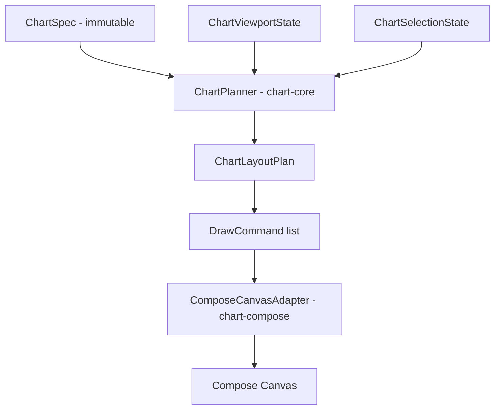

# Core Concepts

ComposePlotLib (1.2.0) ships 26 chart families, but they all share one mental model. If you
understand the four ideas on this page — the planning pipeline, immutable specs, the two-module
split, and hoisted state — every chart family in the library will behave the way you expect.

## The planning pipeline

You never draw anything yourself, and you never mutate a chart object. You describe *what* the
chart is (a spec) and *where you are looking* (viewport + selection state). The library turns that
into a plan, and the plan into pixels.



`ChartPlanner` is a plain Kotlin object with pure functions — `planLineChart`, `planBarChart`,
`planPieChart` and 20 more. There are 23 entry points for the 26 families, because a few families
are presets over another one's planner (`StackedBarChart` plans as a bar chart, `BubbleChart` as a
scatter chart, `Sparkline` as a line chart). Each returns a plan wrapping a `ChartLayoutPlan`,
which holds the resolved `plotBounds`, `canvasBounds`, `xTicks` / `yTicks`, `legendEntries`, and
two lists of `DrawCommand` (`plotDrawCommands`, `overlayDrawCommands`). `DrawCommand` is a small
sealed set — `Line`, `Polyline`, `Rect`, `RoundRect`, `Circle`, `Arc`, `Path`, `Text`, `ClipRect`,
`Group`. `ComposeCanvasAdapter` in `chart-compose` is the only thing that touches a real canvas.

Why you should care as a consumer:

- **Deterministic output.** Same spec + same viewport + same canvas size = byte-identical draw
  commands. There is no hidden animation state or retained mutable chart object drifting between
  frames.
- **Testable without a device.** You can assert on tick values, plot bounds, and legend rows in a
  plain JVM unit test, with no Compose rule and no screenshot harness.
- **One layout engine on both platforms.** Android and iOS run the same `chart-core` planning code;
  only the final draw step is platform Compose.

## Specs are immutable

Every chart's configuration is a Kotlin `data class` with `val` properties. There are no setters
and no builder mutation. To change a chart, you build a new spec — usually with `copy()` — and let
recomposition replan:

```kotlin
val spec = LineChartSpec(
    series = listOf(
        LineSeries(
            id = "revenue",
            label = "Revenue",
            points = listOf(ChartPoint(0.0, 12.0), ChartPoint(1.0, 18.5), ChartPoint(2.0, 15.0)),
        ),
    ),
)

// Toggle a series off without rebuilding the data.
var hidden by remember { mutableStateOf(emptySet<String>()) }
LineChart(
    spec = spec.copy(hiddenSeriesIds = hidden),
    onLegendItemClick = { id -> hidden = if (id in hidden) hidden - id else hidden + id },
)
```

Immutability has a direct consequence for how the library evolves. Because specs are data classes,
**adding a constructor parameter is a source- and binary-breaking change** for anyone using
positional arguments or `copy()`. So new capabilities arrive as *new nested types with defaults*
(`ErrorBarsSpec`, `TrendlineSpec`, `CrosshairSpec`, `DataLabelsSpec`, `ReferenceLine`,
`ChartAnnotation`) rather than as a growing flat parameter list. Two practical habits follow:

- Always use **named arguments** when constructing a spec. Positional construction will break on
  upgrade.
- Prefer `spec.copy(...)` over reconstructing a spec from scratch, so you inherit new defaults.

Public API shape is locked by a binary-compatibility dump
([`chart-compose.api`](https://github.com/mena97villalobos/ComposePlotLib/blob/main/chart-compose/api/chart-compose.api),
[`chart-core.api`](https://github.com/mena97villalobos/ComposePlotLib/blob/main/chart-core/api/jvm/chart-core.api));
CI fails if a signature changes without the dump being updated. Those two files are the exact
inventory of what you can call.

## The two-module split

| Module | What it holds | Depend on it when |
|---|---|---|
| `chart-core` | Geometry, ranges, viewport math, transforms, specs, models, the planner, draw commands | You need chart math or layout with **no UI** |
| `chart-compose` | Public composables, gestures, state wrappers, theming, the canvas adapter | You are drawing a chart (this is the normal case) |

Most apps only add `chart-compose` — it transitively brings `chart-core`. Depending on
`chart-core` alone is useful for headless work: computing ticks or plot bounds on a background
thread, exporting a chart server-side, running layout assertions in a shared KMP test module, or
feeding another renderer. It has no Compose dependency at all — a Gradle task
(`:chart-core:verifyChartCorePurity`) fails the build if a Compose type leaks in.

```kotlin
// chart-core only — no Compose, no Android, runs in a plain JVM test.
val plan = ChartPlanner.planLineChart(
    input = ChartLayoutInput(
        canvasSize = SizeD(width = 800.0, height = 400.0),
        viewport = ChartViewport(
            xRange = ClosedRangeD(0.0, 2.0),
            yRange = ClosedRangeD(0.0, 20.0),
        ),
    ),
    spec = spec,
    selection = null,
)

println(plan.layout.plotBounds)
println(plan.layout.yTicks.map { it.value })
```

Note that `chart-core` measures nothing — text metrics come from the host through
`ChartLayoutInput.textMeasurements`. In Compose, the built-in composables fill that in with
`TextMeasurer` and replan, which is why axis labels and legends are tight rather than guessed.

## State is hoisted, not hidden

Pan, zoom, and selection do **not** live inside the composable. They live in `ChartViewportState`
and `ChartSelectionState`, which you can create yourself:

```kotlin
val viewportState = rememberChartViewportState(initialViewport = defaultViewport(spec))
val selectionState = rememberChartSelectionState()

LineChart(
    spec = spec,
    viewportState = viewportState,
    selectionState = selectionState,
)

Button(onClick = { viewportState.reset() }) { Text("Reset zoom") }
```

If you omit them, each chart composable creates its own via the same `remember*` defaults — so the
simple case stays a one-liner. Hoisting matters when you need to:

- read the current window (`viewportState.viewport`) to drive a header, a legend, or a network fetch;
- drive the viewport programmatically (`reset()`, `fitToData()`, `centerOn(...)`, `panTo(...)`,
  `zoomTo(...)`) from a button, a deep link, or restored state;
- share one `ChartViewportState` across several charts so they pan and zoom together;
- observe or set the selection (`selectionState.selection`, `select(...)`, `clear()`) to sync a
  chart with a list or a detail pane.

A chart that owned its own pan/zoom internally could do none of these without escape hatches. This
is the same hoisting convention the rest of Compose uses, applied to chart state.

The state APIs themselves — constraints, axis policies, gesture configuration, linked viewports,
selection targets — are covered in [Interactivity and State](Interactivity-and-State).

## Where to go next

- [Chart Gallery](Chart-Gallery) — all 26 families with the spec each one takes
- [Interactivity and State](Interactivity-and-State) — viewport, selection, gestures
- [Styling and Theming](Styling-and-Theming) — palettes, chrome, Material integration
- [`docs/architecture.md`](https://github.com/mena97villalobos/ComposePlotLib/blob/main/docs/architecture.md)
  — the canonical architecture reference, including planner passes
- [`docs/module-guide.md`](https://github.com/mena97villalobos/ComposePlotLib/blob/main/docs/module-guide.md)
  — file-level map of what lives in each module
- [`docs/api-and-state.md`](https://github.com/mena97villalobos/ComposePlotLib/blob/main/docs/api-and-state.md)
  — full public API and state reference
